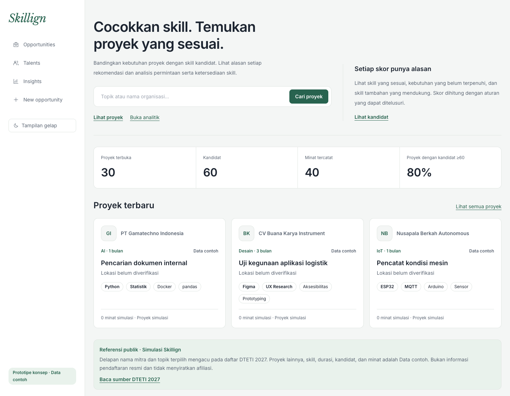
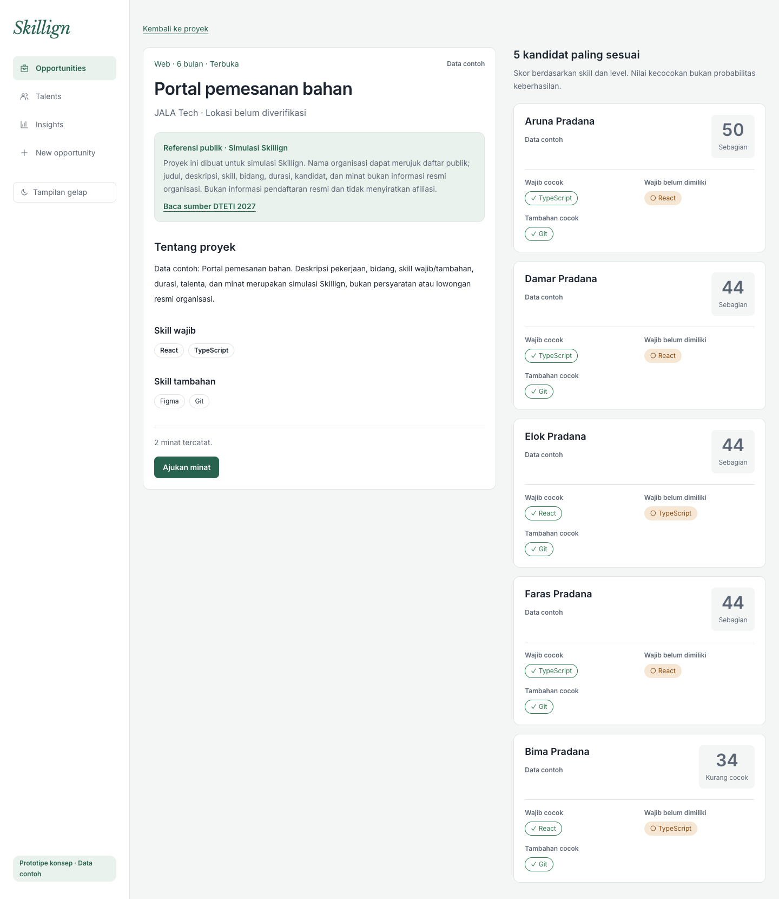
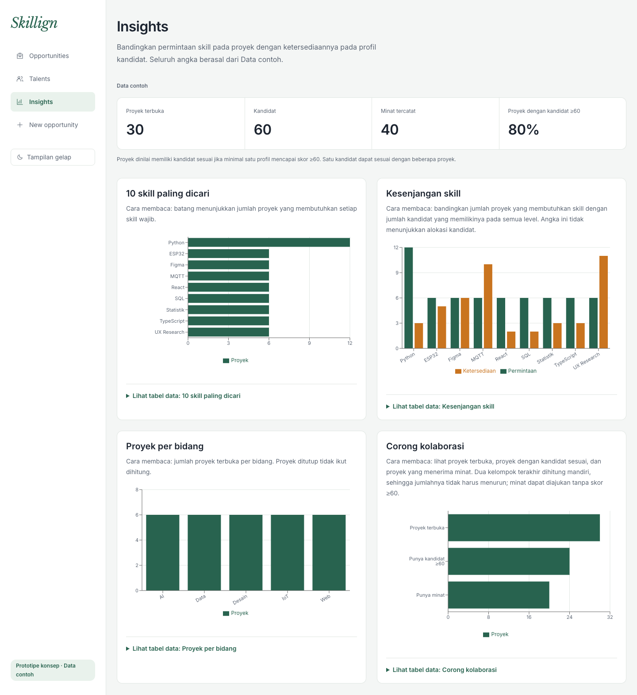
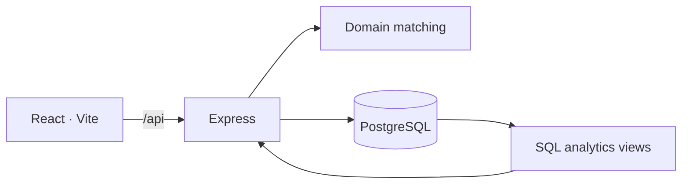

# Skillign

**Explainable skill matching & demand–supply analytics.**

Skillign membantu mahasiswa, dosen, dan pengelola program menemukan kecocokan antara kebutuhan proyek dan skill kandidat. Setiap rekomendasi menyertakan alasan yang dapat ditelusuri; dashboard analitik memperlihatkan permintaan, ketersediaan, dan kesenjangan skill.

**Demo publik: [skillign.vercel.app](https://skillign.vercel.app/)**

[Mulai lokal](#menjalankan-lokal) · [Arsitektur](docs/ARCHITECTURE.md) · [Design system](docs/DESIGN.md) · [Pengujian](#pengujian)

> **Prototipe konsep · Data contoh.** Nama delapan mitra dan judul topik terpilih merujuk sumber publik DTETI. Atribut pencocokan, profil kandidat, dan minat merupakan simulasi. Skillign tidak berafiliasi dengan organisasi yang ditampilkan dan bukan layanan pendaftaran magang resmi.



| Detail proyek dan kandidat paling sesuai | Insights permintaan dan ketersediaan skill |
| --- | --- |
|  |  |

## Fitur

| Halaman | Kemampuan |
| --- | --- |
| **Opportunities** | Pencarian judul/organisasi, filter bidang dan skill, serta detail kebutuhan proyek. Pencarian dan filter tersimpan dalam URL. |
| **Talents** | Profil kandidat, level skill, lima rekomendasi proyek, dan skill yang disarankan untuk dikembangkan. |
| **Explainable matching** | Lima kandidat teratas per proyek, skor 0–100, skill wajib yang sesuai/belum terpenuhi, serta skill tambahan yang mendukung. |
| **Insights** | Permintaan skill, kesenjangan permintaan–ketersediaan, distribusi bidang, ringkasan program, dan corong kolaborasi. |
| **New opportunity** | Form proyek dengan validasi bersama di klien/server dan rekomendasi langsung setelah penyimpanan. |

Pengajuan minat dibatasi satu kali per kandidat/proyek melalui constraint database. Antarmuka menyediakan tema terang/gelap, tabel alternatif untuk grafik, serta state pemuatan, kosong, dan gagal.

## Arsitektur



| Lapisan | Teknologi |
| --- | --- |
| Antarmuka | React 18, TypeScript, Tailwind CSS, React Router |
| Visualisasi | Recharts |
| API & validasi | Express, Zod |
| Penyimpanan | PostgreSQL, driver pg; Neon untuk target hosting |
| Pengujian | Vitest, Testing Library, Supertest, PGlite |
| Deployment | Vercel (region Singapura): frontend statis dan API Functions; Neon (Singapura) |

Logika skor berada dalam fungsi domain murni. Skor dihitung saat permintaan diproses dan tidak disimpan. Agregasi analitik berasal dari view SQL; jumlah proyek dengan kandidat berskor ≥60 dihitung di server menggunakan fungsi domain yang sama.

## Menjalankan lokal

**Prasyarat:** Node.js 22 LTS dan npm. Jalankan perintah dari direktori repository yang berisi `package.json`.

```bash
npm ci
```

Untuk mencoba aplikasi tanpa akun database, buka dua terminal:

```bash
# Terminal 1 — API dengan database contoh sementara
npm run dev:contoh
```

```bash
# Terminal 2 — frontend
npm run dev
```

Buka alamat **Local** yang dicetak Vite. API berjalan di `127.0.0.1:3001`; Vite meneruskan permintaan `/api` ke alamat tersebut. Database contoh berada dalam memori dan kembali ke seed awal setelah API dijalankan ulang.

### Menggunakan PostgreSQL

Salin `.env.example` ke `.env`, lalu isi `DATABASE_URL` dengan koneksi database khusus proyek ini.

```bash
cp .env.example .env
npm run migrasi
```

Untuk mengisi **database contoh yang boleh direset**, atur `ALLOW_SEED_RESET=true` di `.env`, lalu:

```bash
npm run seed
npm run dev:server
```

Jalankan `npm run dev` pada terminal lain. Gunakan salah satu dari `dev:server` atau `dev:contoh`, karena keduanya memakai port 3001.

> Seed mengosongkan tabel proyek dalam satu transaksi. Kembalikan `ALLOW_SEED_RESET=false` setelah selesai. `.env` tidak boleh masuk Git.

## Cara kerja matching

Skill wajib menyumbang **80%** skor; skill tambahan **20%**. Skill wajib memperhitungkan level kandidat: dasar **0,6**, menengah **0,85**, dan mahir **1**. Jika tidak ada skill tambahan, seluruh bobot dialihkan ke skill wajib.

```text
cakupanWajib    = jumlah bobot skill wajib yang dimiliki / jumlah skill wajib
cakupanTambahan = jumlah skill tambahan yang dimiliki / jumlah skill tambahan
skor           = round(100 × (0.8 × cakupanWajib + 0.2 × cakupanTambahan))
```

**Contoh:** React dan SQL wajib; Figma tambahan. Kandidat memiliki React mahir, SQL menengah, dan Figma dasar. Cakupan wajib `(1 + 0.85) / 2 = 0.925`, cakupan tambahan `1`, sehingga skor **94**. Contoh ini diverifikasi melalui pengujian API.

Skill di luar kebutuhan tidak menurunkan skor. Urutan rekomendasi ditentukan oleh skor turun, nama/judul naik, lalu ID sebagai pemecah seri. Skor menunjukkan kecocokan berbasis aturan, **bukan probabilitas diterima**.

## Data & analitik

Seed tetap menghasilkan **40 skill, 12 organisasi, 30 proyek, 60 profil kandidat, dan 40 minat**. Delapan nama mitra dan delapan judul topik merujuk [daftar mitra DTETI 2027](https://sarjana.jteti.ugm.ac.id/akademik/penjelasan-aktivitas-akademik/daftar-mitra-magang-dteti-2027/); empat kampus dan profil kandidat bersifat fiktif. Dua puluh dua judul proyek lainnya dibuat untuk simulasi.

Skill wajib/tambahan, bidang, deskripsi, durasi, status, dan minat tidak mewakili persyaratan resmi mitra. Lokasi organisasi publik belum diverifikasi. Dataset ini merupakan snapshot terpilih, bukan keseluruhan daftar atau sinkronisasi otomatis. [Kebijakan sumber data](docs/decisions/001_referensi-publik-dteti.md).

Analitik memakai enam view: `v_permintaan_skill`, `v_ketersediaan_skill`, `v_kesenjangan_skill`, `v_tantangan_per_bidang`, `v_minat_per_tantangan`, dan `v_ringkasan_program`. Rasio kesenjangan bernilai `NULL` ketika ketersediaan nol. Kelompok “punya kandidat” dan “punya minat” pada corong dihitung mandiri, sehingga tidak menyatakan konversi berurutan.

## Pengujian

```bash
npm run test:run
npm run lint
npm run build
```

Baseline terakhir: **90 pengujian lolos**, mencakup rumus matching, validasi, migrasi/seed, integritas SQL, API, dan interaksi antarmuka. Pengujian tidak memerlukan akun Neon. Cakupan mencakup matching, validasi form, integritas database, sumber data publik, pencarian/filter URL, pengajuan minat, dan tema antarmuka.

## Status & batasan

Fitur inti tersedia di demo publik dan lokal. Autentikasi, kontrol peran, edit/hapus data, dan notifikasi berada di luar cakupan MVP. Data contoh yang ditulis pada demo publik dapat dilihat pengunjung lain.

Deployment terverifikasi pada 8 November 2026: semua endpoint API membalas data dari Neon, refresh langsung pada URL halaman tidak menghasilkan 404, dan tampilan diperiksa pada desktop serta mobile. Fungsi API dijalankan di region Singapura agar dekat dengan database. Halaman Insights tampil lengkap dalam sekitar 0,5 detik pada kunjungan berikutnya dan 1,8 detik pada kunjungan pertama saat fungsi masih dingin.

## Dokumentasi

- [Product brief](PROJECTBRIEF.md) — kebutuhan dan batas produk.
- [Arsitektur](docs/ARCHITECTURE.md) — model data, API, matching, dan view analitik.
- [Design system](docs/DESIGN.md) — tipografi, tema, komponen, dan bahasa produk.

Dikembangkan oleh **Naufal Dzaky** · Teknologi Informasi, Universitas Gadjah Mada.
